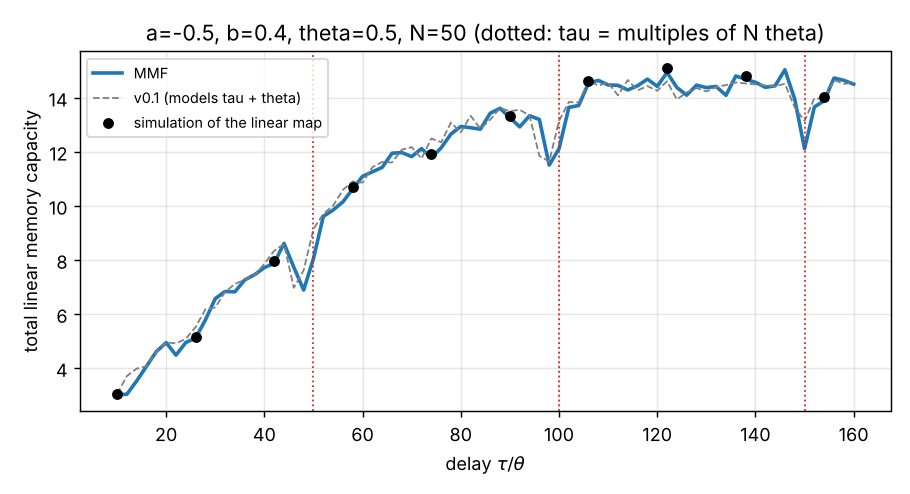

# MMF: master memory function for delay-based reservoir computers

The **master memory function** gives the linear memory capacity of a delay-based reservoir computer with single-variable dynamics and small inputs, from two numbers: the local linearisation $a$ and the delayed-feedback linearisation $b$ (plus the timing $\theta$, $N$, $\tau$). No time series needs to be simulated.

> F. Köster, S. Yanchuk, K. Lüdge, *Master memory function for delay-based reservoir computers with single-variable dynamics*, IEEE Trans. Neural Netw. Learn. Syst. **35**, 7712 (2024), [arXiv:2108.12643](https://arxiv.org/abs/2108.12643)

The repo contains the C++ program (`MMF`) and an equivalent Python package (`mmf`). The Python package also has a reference simulator of the linear map and a parameter scan.

## The model

Linearising $\dot s = f(s(t), s(t-\tau), I(t))$ around its fixed point gives $\delta\dot s = a\,\delta s + b\,\delta s(t-\tau) + c\,I(t)$. Integrating over one virtual-node interval $\theta$ (with $\tau = \nu\theta$) gives the map

$$
s_j = \gamma I_j + p\,s_{j-1} + m\,s_{j-\nu}, \qquad p = e^{a\theta},\quad m = -\tfrac{b}{a}(1-p),
$$

with the time-multiplexed input $I_j = u_{\lfloor j/N\rfloor}\,w_{j \bmod N}$ (mask $w$, $N$ virtual nodes). Unrolling the recursion,

$$
s_j = \gamma \sum_{i,k\ge 0} \binom{i+k}{i}\, p^i m^k\, I_{j-i-k\nu}.
$$

Node $n$ of clock cycle $c$ therefore sees input $u_{c-l}$, with $l = \lceil (i+k\nu-n)/N\rceil$ and mask weight $w_{(n-i-k\nu) \bmod N}$. Collecting the coefficients per recall step $l$ gives the modified state matrix $\tilde S \in \mathbb{R}^{N\times L}$. The memory capacity for recalling $u_{c-l}$ is

$$
C_l = \tilde S_l^\top\big(\tilde S\tilde S^\top + \lambda I\big)^{+}\tilde S_l, \qquad \mathrm{MC} = \sum_l C_l \le N,
$$

with $\lambda = 10^{-6}\max(\tilde S\tilde S^\top)$ by default. The sum over $(i,k)$ stops once every term of a diagonal $i+k$ is below `-relativeThreshold` (default $10^{-6}$).



*Total MC against the delay for $N = 50$ (`examples/delay_scan.py`). The dots are direct simulations of the linear map; their small excess comes from finite-sample bias, about $N/T$ per recall step. Capacity drops when $\tau$ approaches a multiple of the clock cycle $N\theta$. The dashed curve is v0.1, which modelled a delay one node interval too long (see below).*

## C++ program

Requirements: [Armadillo](http://arma.sourceforge.net/) and [Boost](https://www.boost.org/) (headers), e.g. `sudo apt install libarmadillo-dev libboost-dev`.

```bash
make                                   # or: cmake -S . -B build && cmake --build build
./MMF -a -0.5 -b 0.4 -N 100 -tauInTheta 141 -theta 0.5
# -> mmf_output.txt with "Steps  Capacity" per recall step; the total is printed
./MMF -h                               # all options
```

| flag | default | meaning |
|---|---|---|
| `-a` | −0.5 | local linearisation $a<0$ |
| `-b` | 0.4 | delayed-feedback linearisation $b$ |
| `-theta` | 0.5 | virtual node distance $\theta$ |
| `-N` | 100 | number of virtual nodes |
| `-tauInTheta` | 141 | delay $\tau = \nu\theta$ |
| `-delayConvention` | `paper` | `legacy` reproduces v0.1, which modelled $\tau = (\nu+1)\theta$ |
| `-seed` | 0 | seed of the random mask, uniform in $[0, 1)$; same mask as v0.1 |
| `-maskFile` | – | your reservoir's actual mask ($N$ values, $w_n$ for node $n$) |
| `-regularisationParameter` | 1e-6 | Tikhonov $\lambda$ |
| `-regularisationParameterRelative` | 1 | $\lambda$ relative to $\max(\tilde S\tilde S^\top)$ |
| `-relativeThreshold` | 1e-6 | drop terms below this |
| `-maxIterations` | 20000 | largest $i+k$ summed; a warning appears if the series has not converged |
| `-filename` | `mmf_output.txt` | output file |

### Docker

```bash
docker build -t mmf .
docker run --rm -v "$PWD":/work mmf -a -0.5 -b 0.4 -N 100 -tauInTheta 141 -theta 0.5   # writes ./mmf_output.txt
```

## Python

```bash
pip install -e .            # numpy, scipy
```

```python
from mmf import master_memory_function, simulate_memory_capacity, scan

C = master_memory_function(a=-0.5, b=0.4, theta=0.5, N=100, tau_in_theta=141)   # C_l, l = 0, 1, ...
C.sum()                                                                          # total MC

# ground truth: run the linear map with random inputs and measure C_l by regression
C_sim = simulate_memory_capacity(-0.5, 0.4, 0.5, 100, 141, max_recall=len(C))

# total MC over a grid of one parameter
totals = scan("tau_in_theta", range(50, 300), a=-0.5, b=0.4, theta=0.5, N=100)
```

The functions take `mask=` (your mask; otherwise a uniform random one from `seed`), `convention="paper"|"legacy"`, `ridge=`, `ridge_relative=`, `relative_threshold=` and `max_iterations=`. Given the same mask, the C++ and Python results agree to 1e-8.

## Tests

```bash
pip install -e ".[dev]" && make && pytest
```

The tests check that:
- for three parameter sets, the MMF agrees with direct simulations of the linear map to within 0.01 per recall step
- `legacy` is exactly the MMF of a delay one step longer (with the node order reversed)
- the C++ program and the Python package agree
- `-delayConvention legacy` reproduces the original program
- flags behave and invalid input gives errors

CI also builds and runs the Docker image.

## Changes in 0.2

- **The delay was off by one node interval.** v0.1 summed the input offset as $i + k(\nu+1)$ instead of $i + k\nu$, so `-tauInTheta ν` computed the memory function of $\tau = (\nu+1)\theta$. This was confirmed by direct simulation: v0.1 matches a simulation with delay $\nu+1$ to 0.003–0.007 per recall step, but differs from one with delay $\nu$ by up to 0.35 per step and up to 20% in total MC. The default now follows the paper's $\tau = \nu\theta$, and `-delayConvention legacy` keeps the old results reproducible. v0.1 also numbered the nodes in reverse order; that is only a relabelling, equivalent to a reversed mask, so it doesn't change the physics.
- **`-N` above 100 crashed** (the mask was drawn with the default N before `-N` was read), unless `-seed` came after `-N`. All flags are now read before the mask is drawn.
- **The output had 4 decimals,** because Armadillo's printing ignored `setprecision`. It now writes 14 digits and prints the total MC.
- **The Docker image could not be built** (`libarmadillo9` doesn't exist on current Ubuntu). It is now pinned to 24.04 with `libarmadillo12`, and CI builds it.
- **Fixed limits:**
  - truncation now compares $|$term$|$; negative terms counted as "small" before
  - a growing $\tilde S$ replaces the fixed N × 125,000 matrix (100 MB at N = 100)
  - a configurable iteration limit, with a warning instead of silent truncation
- **New:**
  - `-maskFile`, `-maxIterations`, `-h`, input validation, CMake
  - the Python package with a reference simulator and parameter scans
  - tests, CI and an example
